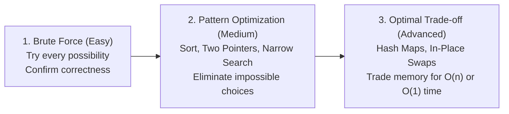

# 🧠 LeetCode Explanations & Visual Tutorials

> An intuitive, step-by-step guide to mastering LeetCode problems — moving from naive brute force to optimal solutions with hand-drawn diagrams, trace tables, teaching guides, and interactive visual animations.

[](https://www.python.org/)
[](https://leetcode.com/)
[](LICENSE)

---

## 🎯 Philosophy: How I Teach

Memorizing optimal solutions rarely helps when interviewers tweak constraints. This repository focuses on **algorithmic intuition and progressive optimization**:



1. **Understand the Mechanics First**: Break down the problem with pen and paper before touching any advanced data structure.
2. **Identify Repeated Work**: Pinpoint *why* the naive solution is slow (e.g., redundant linear scans or recalculations).
3. **Motivate the Data Structure**: Introduce hash tables, pointers, or heaps only as the direct answer to that repeated work.
4. **Visualize Decisions**: Trace state changes step-by-step using tables, Excalidraw diagrams, and HTML animations.

---

## 📚 Problem Catalog

### Arrays & Strings

| # | Problem | Difficulty | Approaches Covered |
|---|---|---|---|
| **0001** | **Two Sum** | Easy | • Brute Force `O(n²)`<br>• Sort + Two Pointers `O(n log n)`<br>• One-pass Hash Map `O(n)` |
| **0014** | **Longest Common Prefix** | Easy | • Vertical Scanning `O(S)` |
| **0026** | **Remove Duplicates from Sorted Array** | Easy | • Auxiliary Array `O(n)` space<br>• Two Pointers In-Place `O(1)` space |

---

## 📂 Repository Structure

```text
leetcode/
├── arrays/
│   ├── Two Sum/
│   │   ├── README.md                     # Complete breakdown & complexity analysis
│   │   ├── teaching-guide.md             # Socratic teaching script & conceptual questions
│   │   ├── easy/
│   │   │   ├── easy_brute_force.py       # Stage 1: O(n²) nested loop approach
│   │   │   └── easy_brute_force.excalidraw
│   │   ├── medium/
│   │   │   ├── medium_sort_two_pointers.py # Stage 2: O(n log n) sorting + two pointers
│   │   │   └── medium_sort_two_pointers.excalidraw
│   │   ├── optimal/
│   │   │   ├── optimal_hash_map.py       # Stage 3: O(n) one-pass hash map
│   │   │   └── optimal_hash_map.excalidraw
│   │   └── animations/                   # Interactive decision-by-decision visualizer
│   │       ├── index.html
│   │       └── index_improved.html
│   │
│   ├── Remove Duplicates/
│   │   └── remove_duplicates.py          # Naive list vs. two-pointer in-place rewrite
│   │
│   └── Longest Common Prefix/
│       └── optimal.py                    # Vertical character comparison
│
└── README.md
```

Each problem folder contains:
- **Solution files** named by strategy (`easy_brute_force.py`, `medium_sort_two_pointers.py`, `optimal_hash_map.py`).
- **`README.md`**: Problem statement, complexity tables (Time & Extra Space), and walkthroughs.
- **`teaching-guide.md`**: Pedagogical guide designed for teaching or recording video tutorials.
- **Visuals (`.excalidraw` / `animations/`)**: Visual assets and step-by-step interactive animations.

---

## 🚀 Running Solutions Locally

All solutions are written in standard Python 3 with zero external dependencies.

### Run an Individual Solution

```bash
# Two Sum - Brute Force
python3 "arrays/Two Sum/easy/easy_brute_force.py"

# Two Sum - Two Pointers
python3 "arrays/Two Sum/medium/medium_sort_two_pointers.py"

# Two Sum - Optimal Hash Map
python3 "arrays/Two Sum/optimal/optimal_hash_map.py"

# Remove Duplicates
python3 "arrays/Remove Duplicates/remove_duplicates.py"

# Longest Common Prefix
python3 "arrays/Longest Common Prefix/optimal.py"
```

### View Interactive Visualizations

Open the HTML visualizers directly in any browser:

```bash
# macOS
open "arrays/Two Sum/animations/index_improved.html"

# Linux
xdg-open "arrays/Two Sum/animations/index_improved.html"

# Windows
start "arrays/Two Sum/animations/index_improved.html"
```

---

## 📐 Template for New Problem Breakdowns

When contributing or adding a new problem, follow this structured pattern:

1. **Create the folder structure**:
   ```text
   <topic>/<Problem Name>/
   ├── README.md
   ├── teaching-guide.md (optional but encouraged)
   ├── easy/
   ├── medium/
   └── optimal/
   ```
2. **Follow naming conventions**:
   - Stage 1: `easy_<strategy>.py` (e.g., `easy_brute_force.py`)
   - Stage 2: `medium_<strategy>.py` (e.g., `medium_sort_two_pointers.py`)
   - Stage 3: `optimal_<strategy>.py` (e.g., `optimal_hash_map.py`)
3. **Include a Complexity Comparison Table** in each problem's `README.md`:

| Stage | Strategy | Time Complexity | Space Complexity | Key Trade-off / Idea |
|---|---|---|---|---|
| Naive | Exhaustive Search | O(n²) | O(1) | High time, no extra memory |
| Intermediate | Sorting / Search | O(n log n) | O(n) | Prunes unnecessary checks |
| Optimal | Hash Table | O(n) | O(n) | Traded memory for instant lookup |

4. **Self-contained runnable code**:
   - Keep the LeetCode `Solution` class signature.
   - Include a simple `__main__` demonstration at the bottom with sample inputs and print outputs.

---

## 🗺️ Roadmap & Upcoming Topics

- [x] **Arrays & Hashing**
  - [x] Two Sum (#1)
  - [x] Longest Common Prefix (#14)
  - [x] Remove Duplicates from Sorted Array (#26)
  - [ ] Best Time to Buy and Sell Stock (#121)
  - [ ] Contains Duplicate (#217)
  - [ ] Valid Anagram (#242)
  - [ ] Group Anagrams (#49)
- [ ] **Two Pointers & Sliding Window**
  - [ ] Valid Palindrome (#125)
  - [ ] 3Sum (#15)
  - [ ] Container With Most Water (#11)
  - [ ] Longest Substring Without Repeating Characters (#3)
- [ ] **Stack & Queues**
  - [ ] Valid Parentheses (#20)
  - [ ] Min Stack (#155)
- [ ] **Binary Search**
  - [ ] Binary Search (#704)
  - [ ] Search a 2D Matrix (#74)
- [ ] **Linked Lists, Trees & Dynamic Programming**
  - [ ] Reverse Linked List (#206)
  - [ ] Invert Binary Tree (#226)
  - [ ] Maximum Subarray / Kadane's (#53)
  - [ ] Climbing Stairs (#70)

---

## 🤝 Contributing

Contributions, problem suggestions, visual diagrams, and alternative solution breakdowns are welcome! Feel free to open an issue or submit a pull request.
